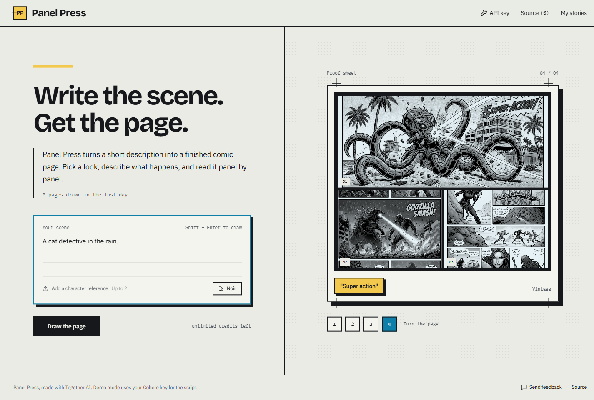

# Panel Press

<p align="center">
  Write the scene. Get the page. Panel Press turns a short description into a finished comic, drawn panel by panel.
</p>



## What it does

Give Panel Press a scene and a visual style. It writes a short comic script, then renders a page with narration and dialogue in every panel. The interface follows a printer's proof sheet: a ruled script area on the left and a paper stage on the right.

## Features

- Comic page generation from a short prompt
- Five visual styles, from noir to manga to vintage
- Character reference uploads for visual consistency
- Panel by panel story editor
- PDF export for finished stories
- Bring your own API key

## Tech stack

- [Next.js 16](https://nextjs.org/) with React 19 and Tailwind CSS
- [Drizzle ORM](https://orm.drizzle.team/) with [Neon](https://neon.tech) PostgreSQL
- [Clerk](https://clerk.com/) for authentication
- [Together AI](https://www.together.ai/) for LLM and image generation
- [AWS S3](https://aws.amazon.com/s3/) for image storage
- [Upstash Redis](https://upstash.com/) for rate limiting
- [jsPDF](https://github.com/parallax/jsPDF) for PDF generation

## Run the local demo

Cohere provides text generation only. Demo mode uses your Cohere key for the script and renders panels as local SVG, so no Clerk, Neon, S3, or Redis account is needed.

1. Install dependencies with `npm install`.
2. Create `.env.local` with these two lines:

   ```env
   NEXT_PUBLIC_DEMO_MODE=1
   COHERE_API_KEY=your_cohere_key
   ```

3. Start the app with `npx next dev --webpack -p 3210`.
4. Open http://localhost:3210, write a short scene, and choose Draw the page.

The webpack flag matters. Next.js 16 defaults to Turbopack, and demo mode uses a webpack alias for the Clerk shim.

## Run the full application

1. Clone the repo: `git clone https://github.com/abdtriedcoding/panel-press.git`.
2. Copy `.example.env` to `.env.local` and fill in the Together AI, S3, Neon, Clerk, and Upstash values.
3. Run `npm install` and `npm run dev`.

## Repository

https://github.com/abdtriedcoding/panel-press
